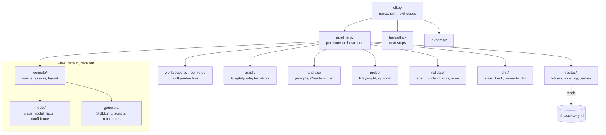

# Architecture overview

skillgendev is a Python 3.10+ package (`src/skillgen/`) with one console entry point,
`skillgendev = "skillgen.cli:main"`. Two data folders ship inside the wheel under
`skillgendev/_data/`: `hintpacks/` (framework knowledge as YAML) and `claude/` (the Claude Code
command, subagent and driver skill).

## Packages

| Package | What it does |
| --- | --- |
| `cli.py` | Argument parsing and output; the **only** module that prints |
| `pipeline.py` | Runs the per-route steps; file and subprocess access at the edge |
| `handoff.py` | The `next` step a stopped run hands to the agent or the developer |
| `workspace.py`, `config.py` | The `.skillgendev/` layout, reading and writing its files; `config.json` |
| `assets.py` | Finds shipped data (`hintpacks/`, `claude/`, the fill engine, the index template) in a wheel or a checkout |
| `export.py` | Folder, zip, Claude Code plugin and ChatGPT plugin export, with `MANIFEST.sha256` and the secret scan |
| `logs.py` | Run logs: console level from `-v`, full debug log in `.skillgendev/logs/` |
| `errors.py` | Every custom exception, all inheriting from `SkillgenError` |
| `graph/` | Graphify adapter, page slices, change impact, likely router files. The only place that imports `graphify` |
| `routes/` | Route probes (folders, ast-grep), merge into `routes.json`, skill names |
| `probe/` | Optional Playwright probe and x/y measurement. The only place that imports `playwright`, and only lazily |
| `analyze/` | The analysis prompt and the headless Claude Code runner |
| `model/` | The page model, facts, sources and confidence |
| `compile/` | Merge facts into `page.json`; compile rules into checks |
| `generate/` | `SKILL.md`, the inline setter, `fill.js`, references, evals, the index page |
| `validate/` | Agent Skills spec checks, model checks, the secret and personal-data scan |
| `drift/` | Stale-skill check and semantic diff |
| `schema/` | JSON schemas for `page.json`, Claude's answers and every CLI `--json` output |

The module-by-module map is in [Module map](./modules.md).

## Pure core, effects at the edge

`model/`, `compile/` and `generate/` are **pure**: no file, network, subprocess, clock or
environment access. They take data and return data. Files and the network are touched only
at the edges: `workspace.py`, `cli.py`, `graph/`, the `routes/` scanners, `analyze/runner.py`
and `probe/`. Shipped data such as the fill engine is read by `assets.py` and passed in as
text.

`tests/test_boundaries.py` enforces this. It scans the pure packages for `open`, `read_text`,
`read_bytes`, `write_text`, `write_bytes`, `Path(`, `getenv`, `resources.files` and
`os.environ`.

## Boundaries the tests enforce

| Rule | Why |
| --- | --- |
| `graphify` is imported only inside `graph/` | One adapter for the code graph |
| `playwright` is imported only inside `probe/`, and lazily | The core works without the `probe` extra |
| No `print` outside `cli.py` | Output is either text lines or schema-checked JSON, in one place |
| No hard-coded tool name | The name lives in `skillgen.TOOL_NAME`; everything else derives from it |
| No MCP | Skills and the library never depend on or mention MCP servers |
| `jsonschema` and `PyYAML` stay off the startup path | `jsonschema` costs about 320 ms and `PyYAML` about 80 ms to import; they are imported where they are used |

## Framework-agnostic by construction

No framework-specific code lives in the core: no `if framework == "vue"`, no import of a
framework's parser, no hard-coded router names. Framework knowledge lives only in
`hintpacks/` as YAML. Deleting `hintpacks/` must leave a working tool. The same holds for
domains: no business vocabulary in code or templates.

## The name

The public name `skillgendev` (PyPI package and command) lives in exactly one constant,
`skillgen.TOOL_NAME`, plus the `[project]` name and script entry in `pyproject.toml`. The
Python import package keeps the folder name `skillgen` (`src/skillgen/`). The workspace
folder (`.skillgendev/`), schema ids, the user-section markers, metadata and the
`SKILLGEN_CHROMIUM` variable all derive from the constant, so a rename is one commit.

## Errors and output

- Expected failures raise subclasses of `SkillgenError`; `cli.main` turns them into exit code 2
  and a one-line message (or `{"ok": false, "error": …}` with `--json`).
- Anything else is a bug: the traceback goes to the run log and the exception is re-raised.
- Every command returns a `Reply` (data plus text lines). `emit` prints the text, or validates
  the JSON payload against the command's schema first.
