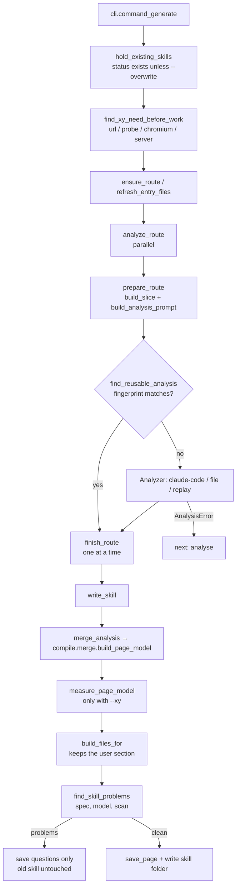

# Pipeline internals

`pipeline.py` orchestrates the per-route steps; `cli.py` only parses arguments and prints.
Analysis runs in parallel; merging and writing run one route at a time, so `routes.json` and
`questions.json` are never written concurrently.

## `generate`, step by step

| Function | Job |
| --- | --- |
| `cli.hold_existing_skills` | Splits routes into those to generate and existing skills to leave alone (status `exists`), before any work |
| `cli.find_xy_need_before_work` | Finds what stops `--xy` (no address, no browser, no server) before any work; x/y is then off for the run |
| `ensure_route` | Returns a route's entry, adding it to `routes.json` when new and filling its code files if it has none |
| `prepare_route` | Builds the analysis request, saves `slice.json` and `prompt.md` (with the answer schema) |
| `fingerprint_request` | Hashes the rendered prompt, the schema and every slice file's bytes |
| `find_reusable_analysis` | Returns the saved analysis when it was made from the current inputs |
| `analyze_route` | Prepares and analyses one route; safe to run for several routes at once |
| `finish_route` | Merges, checks and writes one analysed route |
| `merge_analysis` | Builds the page model from the analysis and the developer's answers |
| `measure_page_model` | With `--xy`: measures x/y, trying the analysis's own open steps and views before asking |
| `with_view_candidates`, `keep_proven_views` | Walks every view the code names, and keeps those whose fields appeared |
| `build_files_for` | Builds the skill's files, keeping the user section of the skill already there |
| `find_skill_problems` | Runs every check on the page model and its files |
| `save_page` | Saves the checked model, `changes.json` and `evidence.jsonl` |

## Code first, `--xy` only adds

A skill is always built from the code alone: `write_skill` merges with no probe. With `--xy`,
`probe.runner.measure_page_layout` opens the page, clicks the route's open steps, and measures
each field **by the skill's own selector** with `probe/measure.js`. The measuring function
returns only a `Layout`, so `--xy` can only add x/y, never change a field.

When x/y could not be measured, `compile.layout.carry_layout` keeps the last run's boxes for
fields whose selector is unchanged. It only verifies, so an outdated box can never aim a
click.

## Open steps and views

Open steps come from two places. The analysis returns them as `open`, and
`compile.merge.merge_open_steps` assesses them like any fact: steps read plainly in the code
are trusted; deduced ones, and any step naming a click that could change data
(`is_risky_step`), become a question. The developer's `--open`, saved in `routes.json`, always
wins.

Views (`model/page.py` `View`: name, `enter` clicks, field keys, optional `leave` clicks) come
from the analysis as `views`. `merge_views` trusts views read in the code and asks about
deduced ones; `find_view_candidates` stops at the first view with a risky click.

## Stopping with a next step

The pipeline only names the need (`errors.Need` on `RouteOutcome.need`).
`handoff.build_next_step` turns it into the question and the commands, so the wording lives in
one place. See [The agent handoff](../concepts/agent-handoff.md).

## Route discovery

`discover_routes` runs every automatic source (`find_route_candidates`: folder packs,
ast-grep router packs, Graphify route nodes), merges them with `routes.merge.merge_routes`
(which keeps developer edits), and saves `routes.json`. When nothing is found, or with
`--ask-claude`, `ask_claude_for_routes` gives Claude Code the ranked hub files from
`graph/hubs.py`.

## The code graph

`graph/codegraph.py` extracts the repository with Graphify and collapses its symbol-level
graph to a file-level one, cached in `.skillgendev/cache/`. A source snapshot (recognised files
and ignore configuration) decides when the cache is stale; generated output never counts.
`graph/connections.py` builds a second graph that Graphify's own `explain` and `path` commands
read, with `graphify extract --code-only` so no model is called. An analysis prompt carries
Graphify's account of the page's component; a missing CLI or a failed query leaves the prompt
with its file list.
