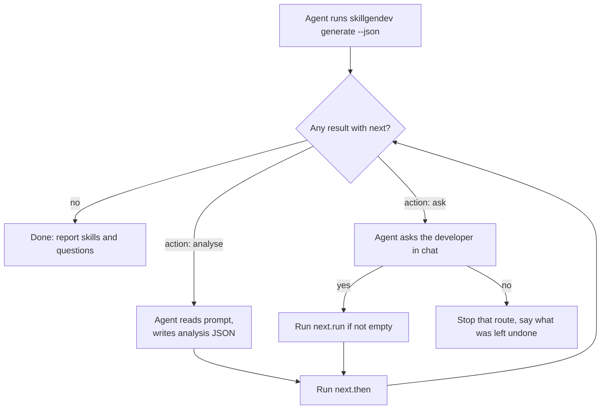

# The agent handoff

Every skillgendev command is run by an AI agent (Claude Code through `/skillgendev`, or another),
never by a person at a terminal that waits. So **no command prompts or waits for input**.

Two kinds of decision follow from that:

1. **Replacing existing output** is the one decision that stops a command before any work.
   It takes a flag for the answer: `generate --overwrite`.
2. **Anything else the developer must do** (give an address, sign in, allow a download, name
   the button that opens a form) never throws work away. The run does all it can from the
   code, then says what is needed. The agent asks the developer in chat and runs the command
   again; analysis is reused while the code is unchanged.

## The `next` object

When a route cannot finish, its result has status `needs` (or `exists`), a `next` object,
and the process exits with code **3**.

```json
{
  "route": "/campaigns/42/edit",
  "skill": "campaign-edit",
  "status": "needs",
  "next": {
    "action": "ask",
    "need": "login",
    "reason": "The page showed a sign-in page.",
    "ask": "This page asks you to sign in before x/y can be measured. Open a browser window so you can sign in now?",
    "run": "skillgendev login --url http://localhost:3000/login",
    "then": "skillgendev generate --route /campaigns/42/edit --name campaign-edit --xy --overwrite",
    "prompt": "",
    "write": ""
  }
}
```

The values above are illustrative; the field names and meanings are exact
(`src/skillgen/schema/cli/generate.schema.json`).

| Field | Meaning |
| --- | --- |
| `action` | `analyse`: the agent reads the code itself. `ask`: only the developer can decide or act |
| `need` | What is missing (table below) |
| `reason` | Why the run stopped, in one sentence |
| `ask` | The question for the developer; empty for `analyse` |
| `run` | The command to run after a yes; empty when the developer acts themselves |
| `then` | The command that continues the work |
| `prompt` | For `analyse`: the prompt file to follow |
| `write` | For `analyse`: where to write the page analysis |

`then` is the same command line again, with `--overwrite` added when the skill was written
and the right flag added for the answer. Placeholders `<url>` and `<label>` in `then` are
replaced by the developer's answer.

## Needs

| `need` | Action | When | What the agent does |
| --- | --- | --- | --- |
| `analysis` | `analyse` | skillgendev could not ask Claude Code (not installed, not signed in) | Reads `prompt` and its files read-only, writes `write`, runs `then` |
| `limit` | `ask` | The AI's own usage limit is reached | Tells the developer when it resets and stops; does **not** analyse by hand |
| `url` | `ask` | `--xy` but no dev address | Asks for the address, puts it in place of `<url>` |
| `probe` | `ask` | The probe extra is not installed | Asks the developer to reinstall with it |
| `chromium` | `ask` | Chromium is not downloaded | Asks to download it (about 150 MB); `run` is `doctor --fix` |
| `server` | `ask` | Nothing answers at the dev address | Asks the developer to start the dev server |
| `login` | `ask` | The page showed a sign-in form | Asks to open a sign-in window; `run` is `login --url …` |
| `open` | `ask` | No field showed, even after trying the code's own open clicks | Asks which button opens the form, puts it in place of `<label>` |
| `overwrite` | `ask` | The skill already exists (status `exists`) | Asks whether to recreate it; `then` adds `--overwrite` |

For every `--xy` need except `open` and `login`, the problem is found **before any work**, x/y
is switched off for that run, and the skill is still written from the code.

## The loop



## Why reruns are cheap

Each analysis is fingerprinted from everything it was given: the rendered prompt (route,
skill, app context, probe summary, Graphify connections), the answer schema, and the bytes of
every file in the page's slice. It is reused while that fingerprint holds, so asking the
developer something and running `then` costs no new analysis. An analysis the agent wrote
after the last request is accepted too. Recorded analyses (`replay`) are never reused.
