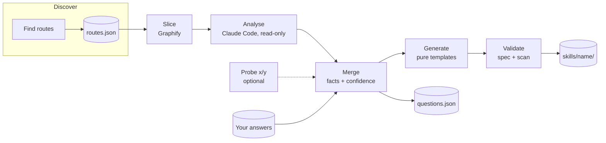
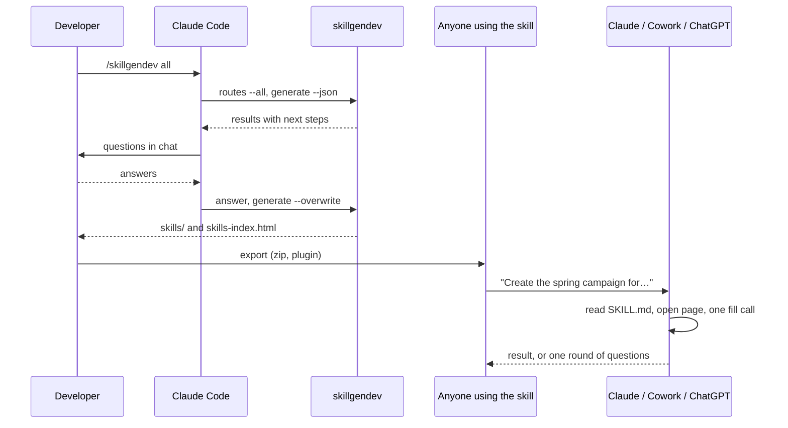

# How it works

skillgendev is a compiler from application code to page skills. It does once, automatically,
what a developer otherwise explains to an AI again and again: what each field represents,
what it accepts, which options are allowed, which fields depend on others, and how the page
behaves.

**Claude Code does the understanding; deterministic tools do the measuring.** Claude reads
code in any language. Graphify, ast-grep, Playwright and the validators supply the facts
Claude should not guess.

## The per-route pipeline

Every route goes through the same steps. Only the analysis uses model tokens.

### 1. Slice

Graphify builds a file-level code graph of the repository (about 30 languages through
tree-sitter). From the page's own entry file, skillgendev walks the graph's links three hops
deep and keeps the files that build that page, nearest first, capped at 40 files or about
60,000 tokens. A page is sliced from its own component, never from the router, so a large
router file does not pull in every page.

Without the graph (`--no-graph`, or when Graphify cannot run) the slice is the route's entry
files only. The slice is saved as `.skillgendev/pages/<skill>/slice.json`.

### 2. Analyse

Claude Code receives the slice's file list, the page's connections as Graphify explains them,
and a JSON schema (`page-analysis.schema.json`). With read-only tools it reads the code and
returns, per field: what it means, accepted values and format, options and where they come
from, conditions, dependencies and server-side rules; and per page: business rules, success
and failure signals, gotchas, the clicks that open a hidden form, and the views (steps, tabs,
dialogs). Anything it deduced rather than read literally is marked `inferred`.

It runs headless (`claude -p --json-schema`), or inside your Claude Code session through
`/skillgendev`. See [Working in Claude Code](../guides/claude-code.md).

### 3. Merge

Deterministic code combines Claude's analysis, any probe facts and your earlier answers
into the page model, `page.json`. Every fact gets a source and a confidence. Facts that are
confident enough go in; the others become questions. See [The page model](./page-model.md).

### 4. Generate

Pure templates turn `page.json` into the skill folder: `SKILL.md`, the inline fill call in
`references/fill.md`, `scripts/fill.js`, `references/locators.md`,
`references/manual-steps.md`, `references/fields.md` for large pages,
`references/layout.json` with `--xy`, and `evals/evals.json`. See
[Anatomy of a skill](./skill-anatomy.md).

### 5. Validate

Agent Skills spec checks (name rules, folder match, quoted description under 300
characters, frontmatter parses, body under 500 lines), model checks (every key known,
dependency graph without cycles), fill-script checks (size and ES2019 syntax) and a secret
and personal-data scan. A skill is written only when every check passes; otherwise only the
questions are saved, so `page.json` and the skill on disk keep matching.

### Optional: measure x/y

With `--xy`, after the skill is built from the code, Playwright opens the page on a dev copy,
makes the open clicks, walks the views, and measures every field by the skill's own
selector. It only adds positions. See [Field positions with --xy](../guides/xy-layout.md).

## Two phases

Only the skill folders and the index page leave the developer's machine. At use time the
AI reads one small skill and fills the page through the user's own browser tab.

## Why it is cheap at use time

The design spec models a 40-field fill at about 8 tool calls with a skill against about 138
with computer use, roughly 25 times fewer input tokens, because the values travel in one
call instead of one action per field. That figure is a model from the spec, not yet a
measurement.

| Fields | Computer use: calls | Skill: calls |
| --- | --- | --- |
| 10 | ~63 | ~8 |
| 40 | ~138 | ~8 |
| 100 | ~288 | ~8 |
