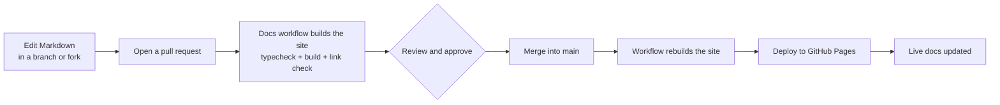

# Improving these docs

This site lives in the repository's `website/` folder: the landing page and these
documentation pages, built with [Docusaurus](https://docusaurus.io/) and styled with Tailwind
CSS. Every page is a Markdown file you can edit in a pull request.

## The fastest way: edit on GitHub

Every page has an **Edit this page** link at the bottom. It opens the page's Markdown file on
GitHub. Without write access, GitHub forks the repository for you; make your change, then
choose **Propose changes** and open a pull request.

## Where pages live

```text
website/
  docs/                    every documentation page (Markdown)
    intro.mdx              /docs/
    getting-started/       installation, quick start, using skills
    guides/                task-focused how-tos
    concepts/              how skillgendev works
    reference/             CLI, JSON output, configuration, workspace, hint packs
    architecture/          internals for contributors
    contributing/          this section
    troubleshooting.md, faq.md
  sidebars.ts              the sidebar's order
  src/pages/index.tsx      the landing page
  src/components/          landing page sections and shared components
  src/css/custom.css       theme tokens, docs styling, Tailwind layers
  static/img/              logo and social card
  docusaurus.config.ts     site configuration
```

### Editing a page

Change the Markdown file. Each page starts with front matter:

```markdown
---
title: Exporting and sharing
description: One sentence for search results and link previews.
---
```

`.md` files are plain CommonMark, so you can write `<skill>` or `{type}` in prose. Use `.mdx`
only when a page needs a React component, and then wrap such text in backticks.

### Adding a page

1. Create the file in the right folder, such as `docs/guides/my-topic.md`.
2. Add its id (the path without the extension, `guides/my-topic`) to `sidebars.ts` where it
   belongs in the reading order.
3. Link to it from related pages with a relative path: `[My topic](../guides/my-topic.md)`.

### Replacing or moving a page

Rename or delete the file, update `sidebars.ts`, and fix every link to it. The build fails on
broken links and anchors, so a missed link is caught before merge.

### Writing guidelines

- **Ground everything in the code.** Commands, flags, defaults and file names must match
  `src/skillgen/`. When the code and the docs disagree, the code wins; fix the docs, or open an
  issue if the code looks wrong.
- Use short sentences and the second person. Show a command, then say what it does.
- Use admonitions (`:::note`, `:::tip`, `:::caution`) sparingly.
- Diagrams use Mermaid code blocks (` ```mermaid `).
- No secrets or real personal data in examples: `example.com`, `555-0100`, obviously fake names.

## Preview locally

You need Node.js 20 or newer.

```bash
cd website
npm ci
npm start              # http://localhost:3000/skillprinter/ with live reload
```

Before you push, run what CI runs:

```bash
npm run typecheck
npm run build          # fails on broken links or anchors
npm run serve          # preview the production build
```

Search is built at build time, so it works in `npm run build` + `npm run serve`, not in
`npm start`.

## From pull request to live site



The workflow is `.github/workflows/docs.yml`. It runs only when files under `website/` (or the
workflow itself) change:

| Event | What happens |
| --- | --- |
| Pull request | `npm ci`, `npm run typecheck`, `npm run build`. A failing build (for example a broken link) shows as a failed check on the pull request. Nothing is deployed |
| Push to `main` (a merged pull request) | The same build, then the `build/` folder is uploaded and deployed to GitHub Pages |
| Manual run (`workflow_dispatch`) | Build and deploy from `main` |

A deployment is never cancelled halfway; a newer pull-request build cancels an older one.

### One-time repository setup (maintainers)

1. **Pages source:** *Settings → Pages → Build and deployment → Source*: choose **GitHub
   Actions**.
2. **Require review before merge:** *Settings → Branches* (or *Rules → Rulesets*) for `main`:
   require a pull request with at least one approval, and require the **Build site** check to
   pass. Then only approved, building changes reach the live site.
3. **Optional hosting variables** (*Settings → Secrets and variables → Actions → Variables*):

| Variable | Use |
| --- | --- |
| `DOCS_URL` | Full origin, such as `https://docs.example.com` |
| `DOCS_DOMAIN` | Just a hostname, when using a custom domain |
| `DOCS_BASE_URL` | Path the site is served under; defaults to `/skillprinter/` on the GitHub Pages project URL and `/` on a custom origin |

With no variables, the site is published at `https://chapeee.github.io/skillprinter/`.

## The landing page

The landing page is `website/src/pages/index.tsx` and its sections in
`website/src/components/landing/`. It uses Tailwind utility classes (configured in
`website/tailwind.config.js`, with Tailwind's base reset turned off so it does not fight
Docusaurus's own styles). The hero's particle waves are plain WebGL in
`components/landing/particles/`. They pause when off screen or in a hidden tab, render a still
frame for reduced motion, and fall back to a 2D canvas without WebGL.
